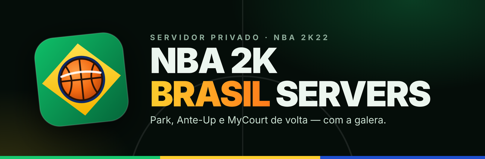
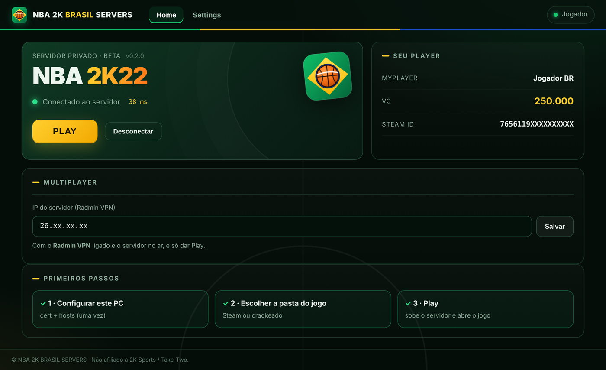
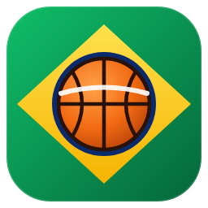

  

  
  
  
  

<h3 align="center">Os servidores oficiais do NBA 2K22 foram desligados. A gente religou a quadra. 🏀🇧🇷</h3>

  O <b>NBA 2K BRASIL SERVERS</b> é um launcher que conecta o seu NBA 2K22 a um servidor privado da comunidade. 
  Você volta pro <b>Park</b>, pro <b>Ante-Up</b> e pro <b>MyCourt</b>, compra roupa na loja e evolui o seu MyPLAYER, tudo com os seus amigos.

  <a href="../../releases/latest"><b>⬇️ Baixar o launcher</b></a>

---

## ✨ O que já funciona

| | |
|---|---|
| 🏙️ **Park** | Entre no Park e veja os outros jogadores andando pela quadra. |
| 💰 **Ante-Up** | As quadras de aposta voltaram, com as mesas de VC. |
| 🏠 **MyCourt** | Sua quadra particular, como antes. |
| 🛍️ **Loja e VC** | Compre roupas, animações e upgrades. Seu VC fica salvo no servidor. |
| 📈 **MyPLAYER** | Evolução de atributos e badges. |
| 🔄 **Atualização automática** | O launcher avisa quando sai versão nova e se atualiza sozinho. |

> 🚧 **Em desenvolvimento:** partidas 1x1 e 3x3 entre jogadores. É a próxima grande entrega.

  

## 🎮 Como jogar

**Você precisa de:**
- NBA 2K22 instalado no PC (Steam)
- [Radmin VPN](https://www.radmin-vpn.com/br/), conectado na rede da galera
- Windows 10 ou 11

**Passo a passo:**

1. **Baixe** o `NBA2K-Brasil-Setup.exe` na [página de releases](../../releases/latest) e instale.
2. **Abra o launcher** e clique em **Configurar agora**. Isso só acontece na primeira vez, e o Windows pede permissão de administrador.
3. Confira se o **IP do servidor** está preenchido e se o Radmin VPN está ligado.
4. Clique em **PLAY**. O launcher conecta no servidor e abre o jogo. 🏀

## 🔄 Atualizações

Você não precisa baixar o instalador de novo. Quando sai uma versão nova, o launcher mostra um aviso e pergunta se você quer atualizar. É só clicar em **Atualizar agora** e ele reinicia já na versão nova.

Se a atualização for **obrigatória** (por exemplo, quando o servidor muda e a versão antiga não consegue mais conectar), o botão **PLAY** fica bloqueado até você atualizar.

## ❓ Perguntas frequentes

<b>O Windows disse que o arquivo pode ser perigoso. É vírus?</b>

 
Não. O aviso aparece porque o instalador ainda não tem assinatura digital paga e é um arquivo novo, com poucos downloads. Além disso, o launcher faz duas coisas que antivírus costumam estranhar:

- adiciona uma linha no arquivo <code>hosts</code>, pra o jogo falar com o nosso servidor e não com o da 2K;
- instala um certificado local, válido só pra esse endereço.

Na tela azul do Windows, clique em <b>Mais informações</b> e depois em <b>Executar assim mesmo</b>. Se quiser desfazer tudo, use <b>Settings → Desfazer setup</b> no launcher.

<b>Isso dá ban na minha conta Steam?</b>

 
O online oficial do NBA 2K22 foi desligado, então não existe mais servidor da 2K pra aplicar ban. O launcher não modifica os arquivos do jogo.

<b>Preciso comprar o jogo de novo ou pagar alguma coisa?</b>

 
Não. Você usa o seu NBA 2K22 e o launcher é gratuito.

<b>O Play diz que não achou o servidor. E agora?</b>

 
Confira se o Radmin VPN está ligado e conectado na rede certa, e se o IP do servidor no launcher está correto. Se ainda assim não conectar, o servidor pode estar desligado no momento.

---

   
  Feito por fãs, pra jogar com os amigos. Projeto sem fins lucrativos. 
  <b>Não afiliado à 2K Sports, Visual Concepts, Take-Two Interactive ou NBA.</b> NBA 2K é marca registrada dos seus respectivos donos.

